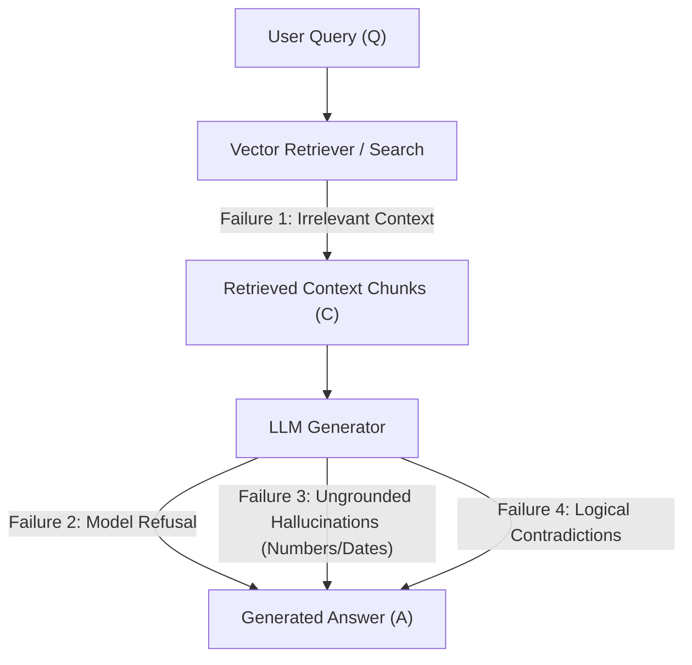
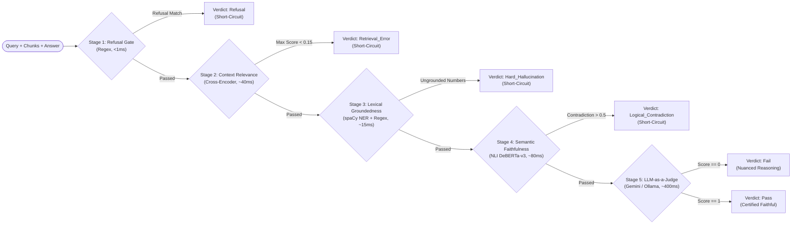
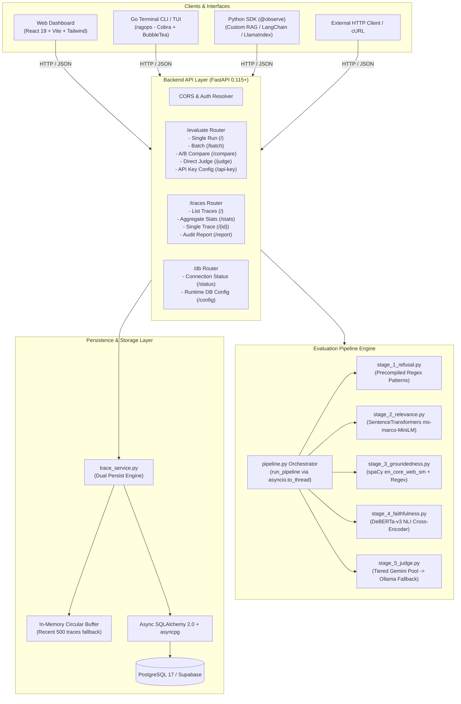
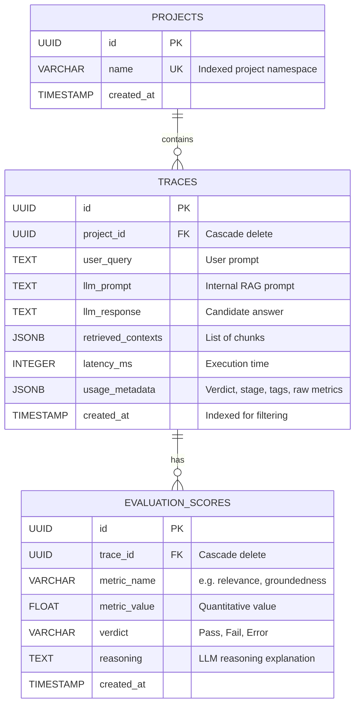

# RAGOps — Complete Technical & Architectural Presentation Guide

> **The 100% Free, Open-Source, Local-First Observability & Fail-Fast Evaluation Platform for Retrieval-Augmented Generation (RAG) Pipelines.**

---

## Table of Contents

- [RAGOps — Complete Technical \& Architectural Presentation Guide](#ragops--complete-technical--architectural-presentation-guide)
  - [Table of Contents](#table-of-contents)
  - [1. Executive Summary \& The Elevator Pitch](#1-executive-summary--the-elevator-pitch)
    - [The 30-Second Pitch](#the-30-second-pitch)
    - [Key Highlights](#key-highlights)
  - [2. The Problem: The Production RAG Reliability Crisis](#2-the-problem-the-production-rag-reliability-crisis)
  - [3. The Solution: The 5-Stage Fail-Fast Architecture](#3-the-solution-the-5-stage-fail-fast-architecture)
    - [Why Fail-Fast Matters](#why-fail-fast-matters)
  - [4. High-Level \& Detailed Backend Architecture](#4-high-level--detailed-backend-architecture)
    - [End-to-End System Component Diagram](#end-to-end-system-component-diagram)
    - [Database Entity-Relationship Diagram](#database-entity-relationship-diagram)
    - [Dynamic Resilience \& Database Decoupling](#dynamic-resilience--database-decoupling)
  - [5. Deep Dive: The 5-Stage Evaluation Pipeline](#5-deep-dive-the-5-stage-evaluation-pipeline)
    - [Stage 1: Sanity \& Refusal Gate (Regex)](#stage-1-sanity--refusal-gate-regex)
    - [Stage 2: Context Relevance (Cross-Encoder)](#stage-2-context-relevance-cross-encoder)
    - [Stage 3: Lexical Groundedness (spaCy NER + Regex)](#stage-3-lexical-groundedness-spacy-ner--regex)
    - [Stage 4: Semantic Faithfulness (NLI Cross-Encoder)](#stage-4-semantic-faithfulness-nli-cross-encoder)
    - [Stage 5: LLM-as-a-Judge (Gemini Pool + Ollama Fallback)](#stage-5-llm-as-a-judge-gemini-pool--ollama-fallback)
  - [6. Core Platform Features in Detail](#6-core-platform-features-in-detail)
    - [Feature 1: Single Run Playground (Interactive Triad Evaluation)](#feature-1-single-run-playground-interactive-triad-evaluation)
    - [Feature 2: Observability \& Trace History (Telemetry \& Reports)](#feature-2-observability--trace-history-telemetry--reports)
    - [Feature 3: Batch Benchmark Evaluation (Dataset Testing at Scale)](#feature-3-batch-benchmark-evaluation-dataset-testing-at-scale)
    - [Feature 4: Model \& Prompt A/B Comparison (Head-to-Head Arena)](#feature-4-model--prompt-ab-comparison-head-to-head-arena)
    - [Feature 5: Pipeline Spec \& System Self-Documentation](#feature-5-pipeline-spec--system-self-documentation)
    - [Feature 6: Multi-Modal Interfaces (Web, Terminal TUI, Python SDK)](#feature-6-multi-modal-interfaces-web-terminal-tui-python-sdk)
      - [1. React 19 Web Dashboard](#1-react-19-web-dashboard)
      - [2. Go Terminal TUI CLI (`ragops`)](#2-go-terminal-tui-cli-ragops)
      - [3. Python SDK \& `@observe` Decorator](#3-python-sdk--observe-decorator)
    - [Feature 7: Zero-Downtime Data Layer \& Self-Healing Backends](#feature-7-zero-downtime-data-layer--self-healing-backends)
  - [7. Mathematical Formulations \& Scoring Logic](#7-mathematical-formulations--scoring-logic)
    - [1. Lexical Groundedness (Jaccard Entity Overlap)](#1-lexical-groundedness-jaccard-entity-overlap)
    - [2. Semantic Faithfulness (Entailment Ratio)](#2-semantic-faithfulness-entailment-ratio)
    - [3. Model Comparison Scoring Function](#3-model-comparison-scoring-function)
  - [8. Backend Implementation Details \& Data Contracts](#8-backend-implementation-details--data-contracts)
    - [Core REST Endpoints](#core-rest-endpoints)
    - [Evaluation Request \& Response Schemas](#evaluation-request--response-schemas)
      - [Request (`POST /evaluate/`)](#request-post-evaluate)
      - [Response (`200 OK`)](#response-200-ok)
  - [9. Step-by-Step 10-Minute Presentation \& Demo Script](#9-step-by-step-10-minute-presentation--demo-script)
    - [Minute 0:00 – 1:30 | The Hook \& The Problem](#minute-000--130--the-hook--the-problem)
    - [Minute 1:30 – 3:30 | The 5-Stage Fail-Fast Concept](#minute-130--330--the-5-stage-fail-fast-concept)
    - [Minute 3:30 – 6:00 | Live Web UI Demo (Single Run \& Presets)](#minute-330--600--live-web-ui-demo-single-run--presets)
    - [Minute 6:00 – 7:30 | Model A/B Comparison \& Batch Benchmark](#minute-600--730--model-ab-comparison--batch-benchmark)
    - [Minute 7:30 – 8:30 | Observability \& Audit Report Export](#minute-730--830--observability--audit-report-export)
    - [Minute 8:30 – 10:00 | CLI, Python SDK, \& Wrap-Up](#minute-830--1000--cli-python-sdk--wrap-up)
  - [10. Anticipated Questions \& Winning Answers (Q\&A Defense)](#10-anticipated-questions--winning-answers-qa-defense)
    - [Q1: "How does RAGOps compare to Ragas or TruLens?"](#q1-how-does-ragops-compare-to-ragas-or-trulens)
    - [Q2: "Why use a Cross-Encoder for Context Relevance instead of Bi-Encoder embeddings?"](#q2-why-use-a-cross-encoder-for-context-relevance-instead-of-bi-encoder-embeddings)
    - [Q3: "What happens if Google Gemini goes down or API keys run out?"](#q3-what-happens-if-google-gemini-goes-down-or-api-keys-run-out)
    - [Q4: "Can RAGOps run completely air-gapped without internet access?"](#q4-can-ragops-run-completely-air-gapped-without-internet-access)
    - [Q5: "How difficult is it to integrate into an existing LangChain or LlamaIndex app?"](#q5-how-difficult-is-it-to-integrate-into-an-existing-langchain-or-llamaindex-app)

---

## 1. Executive Summary & The Elevator Pitch

### The 30-Second Pitch
> *"RAGOps is an open-source, local-first observability and evaluation engine built specifically for Retrieval-Augmented Generation. While traditional evaluation frameworks rely blindly on slow, expensive LLM-as-a-judge calls for every single interaction, RAGOps introduces an intelligent **5-stage fail-fast pipeline** that layers ultra-fast regex, sentence transformers, and spaCy NER before touching a generative model. This cuts evaluation costs by up to 80%, drops evaluation latency to milliseconds for flawed queries, and provides end-to-end trace telemetry with zero external data leakage."*

### Key Highlights
- **100% Free & Open-Source (MIT License)**: No paywalls, no vendor lock-in, no telemetry phoning home.
- **Fail-Fast Efficiency**: Why spend \$0.02 and 2 seconds asking an LLM to evaluate a hallucination when an exact regex or cross-encoder can catch it in 20 milliseconds?
- **Tri-Interface Access**: Web UI (React 19), Terminal TUI (Go + BubbleTea), and programmatic Python SDK with `@observe` decorator.
- **Air-Gapped & Resilient**: Tiered Gemini fallback pool cascading seamlessly to an offline local Ollama model if credentials or internet are absent.
- **Flexible Persistence**: Native PostgreSQL / Supabase async connection pooling paired with an automatic in-memory fallback buffer (500 traces) to guarantee 100% uptime even if databases fail.

---

## 2. The Problem: The Production RAG Reliability Crisis

Retrieval-Augmented Generation (RAG) is the industry standard architecture for connecting Large Language Models to private corporate knowledge bases. However, deploying RAG into production introduces four critical failure modes:


1. **Silent Retrieval Failures**: The vector retriever fetches chunks that have semantic overlap with the prompt keywords but zero factual answers to the actual question. The generator is forced to speculate.
2. **Hard Hallucinations (Entities & Numbers)**: LLMs frequently fabricate exact dates, percentages, financial revenues, or names not present in the retrieved chunks.
3. **Logical Contradictions**: The retrieved text states gross margin *dropped* by 4%, but the LLM states margin *improved* by 4%.
4. **The "LLM-as-a-Judge" Bottleneck**: Existing evaluation platforms (Ragas, TruLens, Langfuse) often invoke heavy generative LLMs for every evaluation step. In production systems serving thousands of queries, this doubles API costs, introduces high latency, and exposes evaluation to LLM non-determinism.

---

## 3. The Solution: The 5-Stage Fail-Fast Architecture

RAGOps resolves this bottleneck with a **cascading complexity hierarchy**. Instead of evaluating everything simultaneously or using an LLM for all checks, evaluations are ordered from **lightest/fastest** to **heaviest/deepest**:



### Why Fail-Fast Matters
| Metric | Pure LLM-as-a-Judge | RAGOps Fail-Fast Pipeline |
|---|---|---|
| **Average Latency on Bad Queries** | 1,500ms – 3,000ms | **1ms – 80ms** |
| **API Token Cost per Evaluation** | \$0.005 – \$0.03 | **\$0.000 (Stages 1-4 are 100% free/local)** |
| **Deterministic Consistency** | Variable (LLM drift) | **100% Deterministic (Stages 1-4)** |
| **Offline Execution** | Impossible | **Fully Supported (Local CPU models + Ollama)** |

---

## 4. High-Level & Detailed Backend Architecture

RAGOps is built as a modular micro-service platform with clean separation between the presentation tier, execution engine, evaluation pipelines, and persistence storage.

### End-to-End System Component Diagram



### Database Entity-Relationship Diagram

The database schema is designed for observability, indexed lookups, and rich metric storage:



### Dynamic Resilience & Database Decoupling
1. **Self-Healing In-Memory Fallback**: If `DB_URL` is empty or PostgreSQL is down, the backend automatically diverts trace storage into a 500-trace in-memory FIFO buffer. The user can continue testing without interruption.
2. **Runtime Hot-Swapping (`POST /db/config`)**: Users can connect a live Supabase or PostgreSQL database directly through the frontend settings modal *without restarting the FastAPI daemon*.

---

## 5. Deep Dive: The 5-Stage Evaluation Pipeline

### Stage 1: Sanity & Refusal Gate (Regex)
- **Goal**: Instantly catch canned LLM refusal patterns before spending resources on semantic analysis.
- **Algorithm**: Precompiled case-insensitive Regular Expressions.
- **Latency**: `< 1ms`.
- **Patterns Evaluated**:
  - `I cannot answer`, `I can't answer`, `I'm unable to`, `I am unable to`
  - `As an AI`, `As a language model`
  - `I don't have .* information`, `I do not have .* information`
  - `I cannot provide`, `my training data`, `outside my capabilities`
- **Short-Circuit Trigger**: If any pattern matches, the pipeline immediately halts and returns `verdict = "Refusal"`, `stage_failed = "stage_1_refusal"`.

### Stage 2: Context Relevance (Cross-Encoder)
- **Goal**: Ensure the context retrieved by the vector database contains relevant information to answer the query ($Q \leftrightarrow C$).
- **Algorithm**: `cross-encoder/ms-marco-MiniLM-L-6-v2` loaded lazily via `sentence_transformers`.
- **Latency**: `~40ms`.
- **How it Works**:
  1. The user query $Q$ is paired with each context chunk $C_i$ into pairs: `[(Q, C_1), (Q, C_2), ..., (Q, C_k)]`.
  2. The cross-encoder evaluates bidirectional cross-attention across the query and chunk tokens simultaneously (far more accurate than cosine similarity of independent bi-encoder vectors).
  3. The maximum chunk score is computed: $\max(S_1, S_2, \dots, S_k)$.
- **Threshold**: Standard threshold is `0.15`.
- **Short-Circuit Trigger**: If $\max(S_k) < 0.15$, the retrieval failed to find relevant context. The pipeline short-circuits with `verdict = "Retrieval_Error"`, `stage_failed = "stage_2_relevance"`.

### Stage 3: Lexical Groundedness (spaCy NER + Regex)
- **Goal**: Guarantee that exact numerical figures and named entities generated in the answer physically exist in the retrieved context chunks ($C \leftrightarrow A$).
- **Algorithm**: Deterministic regex number extraction + `en_core_web_sm` spaCy Named Entity Recognition.
- **Latency**: `~15ms`.
- **How it Works**:
  1. **Numerical Verification**: Regex `\b\d[\d,]*\.?\d*%?\b` extracts all digits, decimals, financial sums, and percentages from both context and answer. The set difference is computed:
     $$\text{Ungrounded Numbers} = \text{Numbers}(A) \setminus \text{Numbers}(C)$$
  2. **Entity Overlap**: spaCy extracts entities under target categories (`ORG`, `GPE`, `LOC`, `PERSON`, `NORP`, `FAC`, `PRODUCT`, `EVENT`, `DATE`). It computes the Jaccard similarity:
     $$\text{Entity Overlap \%} = \frac{|\text{Entities}(A) \cap \text{Entities}(C)|}{|\text{Entities}(A) \cup \text{Entities}(C)|} \times 100$$
- **Short-Circuit Trigger**: If $\text{Ungrounded Numbers} \neq \emptyset$, the answer fabricated statistics. The pipeline halts with `verdict = "Hard_Hallucination"`, `stage_failed = "stage_3_groundedness"`.

### Stage 4: Semantic Faithfulness (NLI Cross-Encoder)
- **Goal**: Verify that the meaning of the generated answer is logically entailed by the retrieved context and contains no contradictions ($C \leftrightarrow A$).
- **Algorithm**: Natural Language Inference (NLI) model `cross-encoder/nli-deberta-v3-small`.
- **Latency**: `~80ms`.
- **How it Works**:
  1. The generated answer $A$ is segmented into individual sentences: $S_1, S_2, \dots, S_m$.
  2. Each sentence is paired with the concatenated context $C$ as the premise: `[(C, S_1), (C, S_2), ..., (C, S_m)]`.
  3. The DeBERTa-v3 model predicts logits for 3 classes: `[Contradiction, Neutral, Entailment]`.
  4. Softmax is applied to normalize class probabilities:
     $$P(\text{class}) = \frac{e^{z_{\text{class}}}}{\sum e^z}$$
  5. The entailment ratio is calculated across all sentences:
     $$\text{Entailment Ratio} = \frac{\text{Count of sentences where } P(\text{Entailment}) > 0.5}{m}$$
- **Short-Circuit Trigger**: If any sentence scores $P(\text{Contradiction}) > 0.5$, the pipeline halts with `verdict = "Logical_Contradiction"`, `stage_failed = "stage_4_faithfulness"`.

### Stage 5: LLM-as-a-Judge (Gemini Pool + Ollama Fallback)
- **Goal**: Evaluate complex qualitative dimensions: multi-hop reasoning, subtle tone, evasive assertions, and completeness.
- **Algorithm**: Tiered Cascading Generative LLM Pool with Structured JSON Output.
- **Latency**: `~400ms – 1,200ms`.
- **Prompt Enrichment**: The judge does not start from scratch! The orchestrator feeds the pre-computed metrics into the prompt:
  - Query, Retrieved Context Chunks, Answer
  - Pre-computed Entity Overlap Percentage
  - Pre-computed Entailment Ratio
- **Tiered Fallback Cascade**:
  ```
  Tier 1: gemini-3.8-flash       (Highest multi-hop intelligence)
     ↓ (on 429 rate limit, quota exhaustion, or network timeout)
  Tier 2: gemini-3.5-flash       (Standard production workhorse)
     ↓
  Tier 3: gemini-3.5-flash-lite  (Low-latency, high rate limits)
     ↓
  Tier 4: gemini-flash-lite-latest (Ultra-low cost fallback)
     ↓
  Final Tier: Local Ollama Model (100% offline, autodetects first local model)
  ```
- **Strict Output Schema**:
  ```json
  {
    "score": 1,
    "reasoning": "The response answers the prompt concisely using facts directly verified in Context Chunks 1 and 2.",
    "model": "gemini-3.5-flash"
  }
  ```
- **Verdict**: Score 1 yields `Pass`; Score 0 yields `Fail`.

---

## 6. Core Platform Features in Detail

### Feature 1: Single Run Playground (Interactive Triad Evaluation)

The Single Run Playground is the interactive core of the web dashboard:
- **Input Triad**: Three synchronized input fields for the user query ($Q$), context chunks ($C$, supporting multiple distinct chunks), and candidate answer ($A$).
- **Live Pipeline Flow Visualizer**: A 5-node horizontal progress bar displaying live execution states (`idle`, `running`, `passed`, `failed`) with stage latency badges.
- **Diagnostic Inspector Panels**:
  - *Relevance Inspector*: Per-chunk relevance scores visualized as percentage bars.
  - *Groundedness Inspector*: Highlighted chips of ungrounded vs grounded numbers and extracted named entities.
  - *Faithfulness Breakdown*: Sentence-by-sentence accordion showing NLI confidence breakdown (Contradiction % vs Neutral % vs Entailment %).
  - *Judge Reasoning Card*: Rich markdown display of the LLM judge's verdict, score, reasoning, and the exact model that judged it.
- **6 Built-in Presets**: One-click test scenarios to demonstrate every single failure gate instantly:
  1. *Clean Pass*: High relevance, grounded facts, 100% entailment, approved by judge.
  2. *Stage 1 Refusal*: Canned refusal caught in `< 1ms`.
  3. *Stage 2 Retrieval Error*: Off-topic context caught by cross-encoder.
  4. *Stage 3 Hard Hallucination*: Fabricated dates/statistics caught by spaCy and regex.
  5. *Stage 4 Logical Contradiction*: Inverted statements caught by DeBERTa-v3 NLI.
  6. *Stage 5 Judge Rejection*: Subtly evasive answer caught by Gemini Flash.

---

### Feature 2: Observability & Trace History (Telemetry & Reports)

Every evaluation is automatically recorded with granular execution telemetry:
- **Trace Metrics Logged**:
  - Unique Trace UUID
  - Project Namespace (e.g. `customer-support`, `financial-qa`)
  - User Query, Context Chunks, and LLM Response
  - Final Verdict & Stage Failed
  - Complete JSON metrics dictionary
  - Wall-clock Latency (ms) & UTC Timestamp
- **Real-Time Aggregate Telemetry Bar**:
  - *Total Traces Evaluated*
  - *Overall Pass Rate %*
  - *Average Latency (ms)*
  - *Average Context Relevance Score ($Q \leftrightarrow C$)*
  - *Average Semantic Faithfulness Ratio ($C \leftrightarrow A$)*
- **Advanced Filtering & Search**:
  - Filter by verdict (`Pass`, `Fail`, `Refusal`, `Retrieval_Error`, `Hard_Hallucination`, `Logical_Contradiction`).
  - Search by query keywords or answer text.
- **One-Click Audit Report Generator (`GET /traces/report`)**:
  - Exports an executive-ready audit report in **Markdown (`.md`)** or **JSON (`.json`)**.
  - Includes executive summaries, gate failure breakdowns, verdict distributions, and automated system health recommendations.

---

### Feature 3: Batch Benchmark Evaluation (Dataset Testing at Scale)

RAGOps allows engineering teams to benchmark entire datasets before deploying model or prompt changes:
- **Controlled Concurrency**: Utilizes `asyncio.Semaphore` (configurable 1–10 workers, default 4) to evaluate datasets in parallel without overloading system resources or triggering rate limits.
- **Dataset Import**:
  - Supports uploading custom `.json` datasets.
  - Built-in sample benchmark dataset for instant testing.
- **Aggregated Benchmark Scorecards**:
  - Total cases evaluated, passed, failed, and overall Pass Rate %.
  - Per-gate failure count distribution (identifies whether retrieval or generation is the bottleneck).
  - Total execution duration and average latency per test case.
- **Deep Itemized Accordion**: Expand any row in the batch results to inspect its query, context chunks, failed gate, and LLM judge reasoning.

---

### Feature 4: Model & Prompt A/B Comparison (Head-to-Head Arena)

Compare two candidate responses under identical context and evaluation gates:
- **Side-by-Side Dual Editor**:
  - Shared query and context chunks.
  - Candidate A (e.g. "Prompt A - Concise / GPT-4o") vs Candidate B (e.g. "Prompt B - Verbose / Claude 3.5 Sonnet").
- **Concurrent Dual Execution**:
  - Both candidates are evaluated concurrently using `asyncio.gather`.
- **Automated Winner Algorithm**:
  $$\text{Score} = (10 \text{ if Pass else } 0) + \text{JudgeScore} + \text{EntailmentRatio}$$
  - A candidate that passes all gates beats a failing candidate.
  - If both pass, the system breaks ties using semantic faithfulness and judge score.
- **Decision Rationale Banner**: Highlights the winning candidate with a detailed comparative summary explaining why one model outperformed the other.

---

### Feature 5: Pipeline Spec & System Self-Documentation

Built directly into the web dashboard, the Pipeline Spec view provides transparent documentation for stakeholders:
- Card-by-card breakdown of all 5 stages.
- Explicit algorithm names, execution speeds, fail conditions, and verdict tags.
- Direct quick-start commands and CLI documentation for developers.

---

### Feature 6: Multi-Modal Interfaces (Web, Terminal TUI, Python SDK)

RAGOps fits seamlessly into any developer workflow:

#### 1. React 19 Web Dashboard
- Beautiful modern interface built with Tailwind CSS, Lucide icons, and Shadcn UI.
- Dark & Light mode toggle with local storage persistence.
- Auto-reconnecting health banner with live cold-start timers.

#### 2. Go Terminal TUI CLI (`ragops`)
- Built with [Cobra](https://github.com/spf13/cobra) and [BubbleTea](https://github.com/charmbracelet/bubbletea).
- Available via Homebrew (`brew install Pixie2468/rag-ops/ragops`) or cross-compiled binary.
- Commands:
  ```bash
  ragops up        # Spin up local Docker stack & open web UI
  ragops run data.json # Evaluate interaction in terminal with interactive spinner
  ragops status    # Check API, database, and LLM judge health
  ragops ui        # Open Web Dashboard in default browser
  ragops down      # Stop local Docker stack
  ```

#### 3. Python SDK & `@observe` Decorator
- Zero-friction integration into Python RAG applications (LangChain, LlamaIndex, Haystack, or custom code):
  ```python
  from rag_ops.sdk import RAGOpsClient, observe

  client = RAGOpsClient(base_url="http://localhost:8000")

  @observe(client=client, project="finance-qa")
  def answer_question(user_query: str):
      chunks = retriever.get_relevant_documents(user_query)
      answer = llm.generate(user_query, chunks)
      return {
          "query": user_query,
          "context_chunks": [c.page_content for c in chunks],
          "answer": answer,
      }

  # Result is automatically evaluated through the 5 gates and logged to Supabase!
  response = answer_question("What is our Q3 operating margin?")
  ```

---

### Feature 7: Zero-Downtime Data Layer & Self-Healing Backends

- **Dynamic API Key Configuration**: Provide Gemini API keys in the payload, HTTP headers (`X-API-Key` or `Authorization: Bearer`), or configure them globally via `POST /evaluate/api-key`. Keys can be validated against Google servers before saving.
- **Masked Key Display**: Sensitive secrets are masked (`AIza...x8Q9`) to prevent accidental leaks during presentations or screenshots.
- **Full Air-Gapped Local Mode**: If no cloud API keys exist, Ollama is automatically launched via `ollama serve` and the local model evaluates the prompt offline.

---

## 7. Mathematical Formulations & Scoring Logic

### 1. Lexical Groundedness (Jaccard Entity Overlap)
Let $E_A$ be the set of named entities extracted from Answer $A$, and $E_C$ be the set of named entities extracted from Context $C$:

$$\text{Overlap}(A, C) = 
\begin{cases} 
1.0 & \text{if } |E_A \cup E_C| = 0 \\ 
\frac{|E_A \cap E_C|}{|E_A \cup E_C|} & \text{otherwise} 
\end{cases}$$

### 2. Semantic Faithfulness (Entailment Ratio)
Let $A = \{S_1, S_2, \dots, S_m\}$ be the set of sentences in Answer $A$, and let $P(\text{Entailment} \mid C, S_i)$ be the DeBERTa-v3 softmax probability:

$$\text{Entailment Ratio} = \frac{1}{m} \sum_{i=1}^{m} \mathbb{I}\left(P(\text{Entailment} \mid C, S_i) > 0.5\right)$$

Where $\mathbb{I}(\cdot)$ is the indicator function. If for any $S_i$:
$$P(\text{Contradiction} \mid C, S_i) > 0.5 \implies \text{Verdict} = \text{Logical\_Contradiction}$$

### 3. Model Comparison Scoring Function
For Candidate $X \in \{A, B\}$:

$$\text{Score}(X) = 10 \cdot \mathbb{I}(\text{Verdict}_X = \text{"Pass"}) + \text{JudgeScore}_X + \text{EntailmentRatio}_X$$

- If $\text{Score}(A) > \text{Score}(B) + 0.05 \implies \text{Winner} = A$
- If $\text{Score}(B) > \text{Score}(A) + 0.05 \implies \text{Winner} = B$
- Otherwise $\implies \text{Winner} = \text{"Tie"}$

---

## 8. Backend Implementation Details & Data Contracts

### Core REST Endpoints

| Method | Endpoint | Description |
|---|---|---|
| `POST` | `/evaluate/` | Executes 5-stage pipeline, logs trace to DB, returns verdict & metrics. |
| `POST` | `/evaluate/batch` | Concurrently evaluates a list of test cases with semaphore throttling. |
| `POST` | `/evaluate/compare` | Head-to-head comparison of two candidate responses with winning analysis. |
| `POST` | `/evaluate/judge` | Direct execution of Stage 5 LLM Judge (with Gemini & Ollama cascade). |
| `GET` | `/traces/` | Paginated trace history with search and verdict filtering. |
| `GET` | `/traces/stats` | Aggregated telemetry (pass rate, latency, failure distributions). |
| `GET` | `/traces/report` | Generates executive audit report in Markdown or JSON format. |
| `GET` | `/db/status` | Current database connection status and provider type. |
| `POST` | `/db/config` | Hot-swap database connection string at runtime. |
| `GET` | `/health` | System health check and model/database readiness probe. |

### Evaluation Request & Response Schemas

#### Request (`POST /evaluate/`)
```json
{
  "query": "What is the capital of France and what is its population?",
  "context_chunks": [
    "France is a country in Western Europe. Paris is the capital and most populous city of France.",
    "As of 2023, the city of Paris has an estimated municipal population of over 2.1 million residents."
  ],
  "answer": "The capital of France is Paris, which has a population of over 2.1 million residents.",
  "project_name": "customer-qa",
  "api_key": "optional-gemini-key",
  "model": "gemini-3.5-flash"
}
```

#### Response (`200 OK`)
```json
{
  "verdict": "Pass",
  "stage_failed": null,
  "tags": ["Pass"],
  "metrics": {
    "max_chunk_score": 0.884,
    "per_chunk_scores": [0.884, 0.742],
    "numbers_grounded": true,
    "answer_numbers": ["2.1"],
    "ungrounded_numbers": [],
    "entity_overlap_pct": 1.0,
    "answer_entities": ["France", "Paris"],
    "context_entities": ["France", "Western Europe", "Paris", "2023"],
    "entailment_ratio": 1.0,
    "has_contradiction": false,
    "per_sentence_scores": [
      {
        "sentence": "The capital of France is Paris, which has a population of over 2.1 million residents.",
        "contradiction": 0.002,
        "neutral": 0.012,
        "entailment": 0.986
      }
    ],
    "judge_model": "gemini-3.5-flash"
  },
  "judge_score": 1,
  "judge_reasoning": "The response directly answers the query with verified facts from the context. Tone is objective and faithful.",
  "trace_id": "c7a8b432-843e-4368-a40e-7473d09a259c",
  "latency_ms": 385,
  "query": "What is the capital of France and what is its population?",
  "answer": "The capital of France is Paris, which has a population of over 2.1 million residents."
}
```

---

## 9. Step-by-Step 10-Minute Presentation & Demo Script

When presenting RAGOps to teammates, leadership, or hackathon judges, follow this structured demo script:

### Minute 0:00 – 1:30 | The Hook & The Problem
- **Say**: *"We all know RAG is the standard way to connect LLMs to data. But when RAG fails in production, how do you know? Did the retriever grab bad documents? Did the LLM fabricate numbers? Did it refuse the prompt? Today, most companies use an LLM to evaluate every query. That's slow, expensive, and fragile. We built RAGOps: an open-source, fail-fast observability platform."*
- **Visual**: Show the slide or Mermaid diagram of the 5-Stage Fail-Fast Pipeline.

### Minute 1:30 – 3:30 | The 5-Stage Fail-Fast Concept
- **Say**: *"Notice our philosophy: we don't call Gemini or GPT-4o right away. We layer lightweight filters first. Stage 1 checks for refusals in under 1 millisecond. Stage 2 checks if retrieved chunks are actually relevant using a cross-encoder. Stage 3 checks if numbers and names exist in the context using spaCy and regex. Stage 4 checks semantic contradiction using DeBERTa. Only if an answer passes all four do we call an LLM-as-a-Judge for tone and nuance. If any stage fails, it short-circuits instantly, saving 80% of our compute."*

### Minute 3:30 – 6:00 | Live Web UI Demo (Single Run & Presets)
- **Action**: Open `http://localhost:3000`.
- **Demo Preset 1 (Clean Pass)**: Click the **"Clean Pass"** preset and hit **Evaluate**. Point to the green pipeline bar and the Metrics Inspector.
- **Demo Preset 2 (Refusal Gate)**: Click **"Stage 1: Refusal Detected"** and hit **Evaluate**. Show how the evaluation halted in `< 1ms` with verdict `Refusal`.
- **Demo Preset 3 (Hard Hallucination)**: Click **"Stage 3: Lexical Hallucination"** (the Python release year and developer count example). Show how the inspector immediately flags the ungrounded numbers `1991` and `8,500,000`.

### Minute 6:00 – 7:30 | Model A/B Comparison & Batch Benchmark
- **Action**: Click the **Model A/B Compare** tab.
- **Say**: *"When engineering prompts or testing a cheaper model against an expensive one, you can run them head-to-head."*
- **Action**: Click **Run Head-to-Head Compare**. Show how the winner banner automatically awards victory based on factual entailment.
- **Action**: Switch to the **Batch Benchmark** tab. Run the batch dataset to show how teams can regression-test entire evaluation suites with parallel concurrency.

### Minute 7:30 – 8:30 | Observability & Audit Report Export
- **Action**: Click the **Observability & Traces** tab.
- **Say**: *"Every interaction is logged with full telemetry: pass rate, latency, and gate failure distributions. And when leadership asks for compliance, you can click 'Download Report' to generate a clean, executive-ready Markdown or JSON audit report."*
- **Action**: Click **Download Report (Markdown)** and show the generated document.

### Minute 8:30 – 10:00 | CLI, Python SDK, & Wrap-Up
- **Action**: Open terminal, show `ragops status` and `ragops run data.json`.
- **Say**: *"Developers can run this entirely in their terminal via our Go Homebrew CLI, or instrument their code with just two lines using our Python `@observe` decorator. It's 100% free, MIT licensed, and self-hosted."*
- **Close**: *"Thank you! We're ready for questions."*

---

## 10. Anticipated Questions & Winning Answers (Q&A Defense)

### Q1: "How does RAGOps compare to Ragas or TruLens?"
> **Winning Answer**:
> *"Ragas and TruLens are great research tools, but in production, they are heavy and rely primarily on expensive LLM calls for almost every metric. RAGOps is engineered for production performance with a **fail-fast architecture**: lightweight deterministic NLP (regex, spaCy, cross-encoders) short-circuits bad answers in 15–40ms before ever invoking an LLM. Furthermore, RAGOps provides a complete out-of-the-box system: a React dashboard, a Go terminal CLI, live observability telemetry, and offline Ollama fallbacks, whereas others are typically just Python libraries."*

### Q2: "Why use a Cross-Encoder for Context Relevance instead of Bi-Encoder embeddings?"
> **Winning Answer**:
> *"Bi-encoders (like standard vector embeddings) encode the query and context independently into vector embeddings, comparing them via cosine similarity. While fast for searching millions of documents, they miss fine-grained token-level interactions. A cross-encoder feeds the query and chunk together into cross-attention layers, analyzing contextual relationships between every word. This yields significantly higher scoring accuracy for verifying if the top retrieved chunks actually answer the prompt."*

### Q3: "What happens if Google Gemini goes down or API keys run out?"
> **Winning Answer**:
> *"RAGOps features a zero-downtime cascading fallback pool. It automatically attempts `gemini-3.8-flash` $\rightarrow$ `gemini-3.5-flash` $\rightarrow$ `gemini-3.5-flash-lite` $\rightarrow$ `gemini-flash-lite-latest`. If all cloud keys fail, rate-limit, or are absent, it automatically cascades down to a local Ollama daemon, spins up `ollama serve` if needed, and uses the first local model (like Llama 3 or Qwen) with zero internet dependence."*

### Q4: "Can RAGOps run completely air-gapped without internet access?"
> **Winning Answer**:
> *"Yes. Stages 1 through 4 use local Python libraries (`re`, `spaCy`, `sentence-transformers`) that run entirely on local CPU. Stage 5 cascades directly to local Ollama. Traces can be persisted to an on-premise PostgreSQL container or held in the local in-memory buffer. Zero data ever leaves your VPC."*

### Q5: "How difficult is it to integrate into an existing LangChain or LlamaIndex app?"
> **Winning Answer**:
> *"It takes exactly two lines of code. You import `from rag_ops.sdk import RAGOpsClient, observe` and wrap your RAG pipeline function with `@observe(client=client, project='your-app')`. The decorator automatically intercepts the query, context chunks, and generated response, evaluates them in the background, and logs the trace to your dashboard."*

---

*Document compiled for RAGOps technical presentations, investor pitches, and architectural reviews.*

